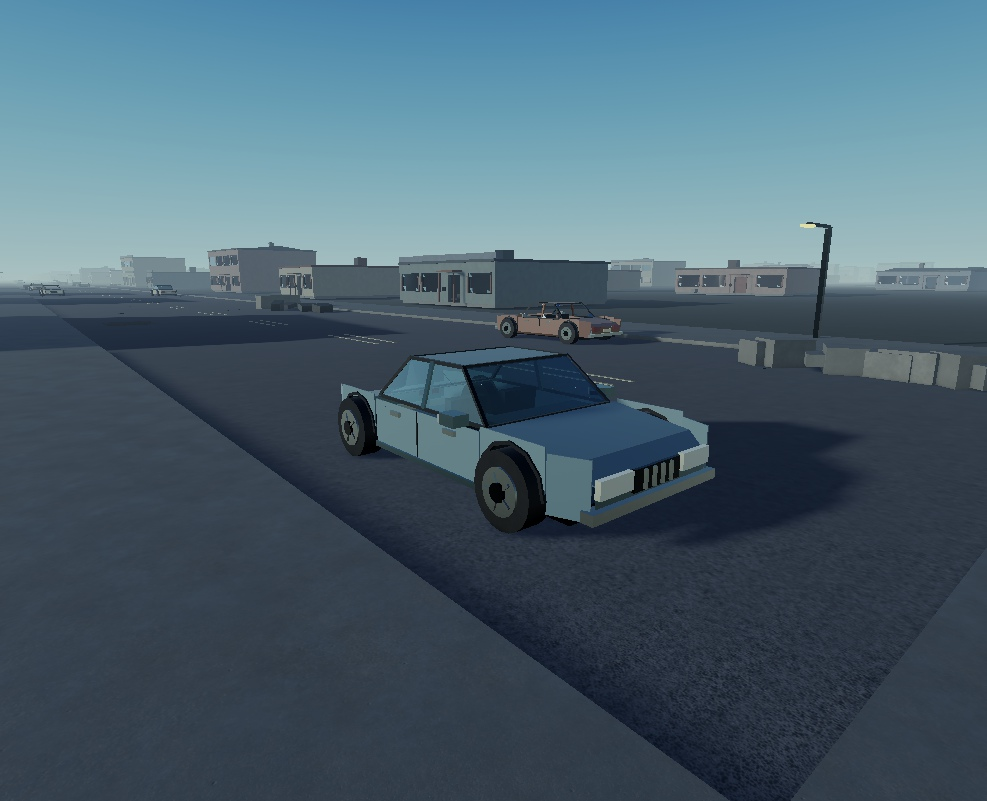

# Карта заброшенного города — V4, 31.10.2026

Подготовлено агентом Разработчик по запросу пользователя. Это самостоятельный снимок карты из Studio, не завершённая интеграция фазы 2 с игровым кодом репозитория.

## Скачать и открыть

1. Скачайте [архив карты](../../places/AbandonedCity-V4.zip) кнопкой **Download raw file** на странице файла GitHub.
2. Распакуйте `AbandonedCity-V4.rbxlx`.
3. В Roblox Studio нажмите **Ctrl+O** и выберите распакованный файл.
4. Запустите **Play**. Персонаж появляется у стартового убежища; физические двери открываются по **E**.

Архив содержит полный XML-плейс с Workspace, освещением, настройками камеры и прыжка, серверным скриптом дверей. Размер распакованного файла — 295 865 286 байт. Размеры и контрольные суммы записаны в [манифесте](../../places/AbandonedCity-V4.manifest.json). Предыдущая карта `places/AbandonedCity-v0.1.0.rbxl` сохранена без изменений.

## Что входит

| Параметр | Значение |
|---|---|
| Размер карты | 6400 × 15 300 studs |
| Главная дорога | 12 600 studs, ширина 56 |
| Поперечные дороги | Ширина 28 studs |
| Здания | 1641 |
| Дополнительные кварталы | 28, асимметричная планировка |
| Автомобили | 107 брошенных седанов/хэтчбеков и одна скорая |
| Количество деталей карты | 228 950 |
| Максимальная оценка здания | 4176 треугольников |

У жилых домов, многоэтажек, магазинов, аптек, автосервисов, складов, больницы и заправки разные фасадные признаки и пиктограммы. Больница имеет отдельный корпус, портик, скорую и площадку на крыше; заправка — шесть колонок, навес, пилон и магазин.

Во всех зданиях восстановлены полные боковые и задние стены и сплошные крыши. Износ локальный: отсутствуют прежние огромные вырезы стен и кровли. Машины имеют гранёный кузов, наклонные стёкла, колёсные арки, круглые шины и диски, фары, решётку, зеркала и салон. Это неподвижные декорации и объезжаемые препятствия, а не управляемый транспорт.

Решения владельца (передано агентом Разработчик): обычный этаж 12 studs, первый коммерческий этаж 16; камера от первого лица; прыжок 4,5 studs. Pivot зданий установлен на Y = 120.

## Двери и стёкла

- 1641 физическая дверь на петле: 656 целых, 985 повреждённых.
- Все 4553 окна первых этажей разбиты.
- На верхних этажах 2130 целых окон из 5324: около 40% с округлением до целого объекта.
- Разбитые стёкла представлены тонкими треугольными осколками с открытой серединой окна.

## Проверки и исправления независимого агента

- 44 307 лучей по боковым/задним стенам и 14 769 по крышам всех 1641 зданий: пропусков нет.
- Все 1641 вход проверены на посторонние коллизии; препятствий в проёмах нет.
- Агент исправил ориентацию 23 241 стеклянного осколка.
- Агент переставил восемь машин, пересекавших поперечные тротуары. Все 432 колеса касаются покрытия с погрешностью менее 0,000001 stud; пересечений габаритов автомобилей с окружением нет.
- Геометрически проверен свободный центральный коридор 16 × 12 600 studs.
- Типы зданий, седан, хэтчбек и скорая осмотрены на скриншотах с разных ракурсов.

В Play проверены физическое открытие целой двери по E и проход персонажа внутрь, а также подъём по лестницам в трёх зданиях, включая пятиэтажный дом и коммерческий первый этаж высотой 16 studs. Консоль при этих проверках чистая.

Экспорт проверен XML-парсером: 228 950 деталей, 1641 сплошная кровля, 432 шины, 1641 дверная петля, 1641 подсказка взаимодействия и один серверный скрипт. Старых `BrokenWall` и `BrokenRoof` нет. Образец здания повторно загружен движком Roblox из XML; этажность, pivot, дверные петли, соединения и подсказки восстановились. Архив прочитан обратно, контрольная сумма распакованного плейса совпала с оригиналом.

## Ограничения для интеграции

- Полный сохранённый файл повторно через окно Studio не открывался; Play-проверки выполнялись в исходном открытом Place1, проверка повторной загрузки XML — на образце здания.
- На реальном телефоне эта версия не проверялась. Замер около 60 FPS на текущем ПК у старта относился к более ранней версии и не подтверждает производительность V4 на телефонах.
- Карта не подключена к Rojo/загрузчику/системам игры в `src/`. В снимке есть самостоятельный `ServerScriptService.CityPhysicalDoors`; при интеграции его нужно перенести в проектный код и сверить с правилами репозитория.
- Отдельный набор моделей по MeshPart-контракту художника не поставляется: снимок собран из примитивов Studio. Это не статус `ready` для каталога художественных ассетов и не завершение всей фазы 2.
- Исходники `src/` и конфиги в этом PR не менялись, поэтому линтеры и тесты исходного кода не запускались.

## Превью

